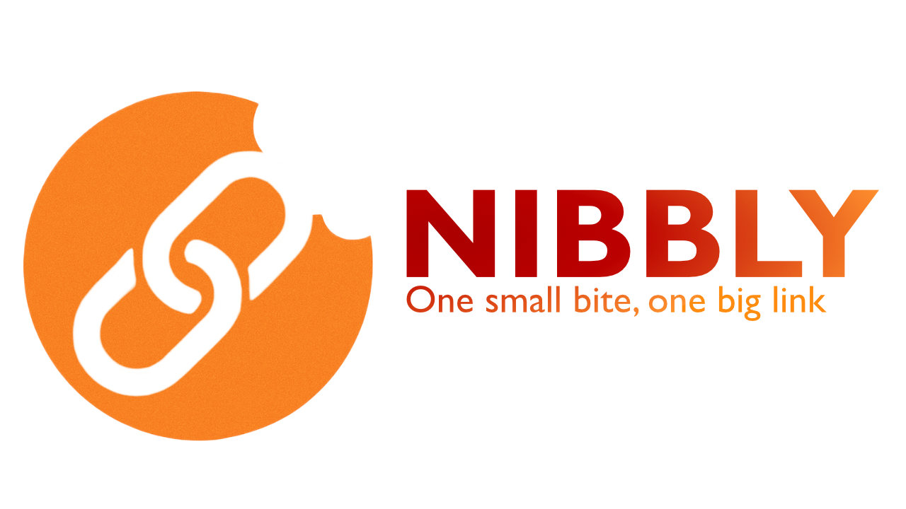

<a id="readme-top"></a>

<!-- PROJECT LOGO -->
<br />
<div align="center">
  <a href="https://github.com/tovade/nibbly">
    
  </a>

  <h3 align="center">Nibbly</h3>

  <p align="center">
    One small bite, one big link!
  </p>
</div>

<!-- ABOUT THE PROJECT -->

## About The Project

This is a shorturl service. I've made this for fun so the code isn't really that good probably. I did my best and I actually enjoyed making this project :D. Please don't judge too hard, this is just a hobby project. I don't have plans to host this online just yet, I don't have a host and I don't want to put data at risk :). The backend is written myself, the frontend was partially coded with the assistance of AI. Mostly cause I'm still new to tailwind and the goal of this project wasn't really frontend at all.

<p align="right">(<a href="#readme-top">back to top</a>)</p>

### Built With

- **[Bun](https://bun.sh/)** - Runtime and package manager
- **[Elysia](https://elysiajs.com/)** - Fast and friendly Bun web framework
- **[Better Auth](https://www.better-auth.com/)** - Authentication library
- **[Drizzle ORM](https://orm.drizzle.team/)** - Lightweight and performant ORM
- **[PostgreSQL](https://www.postgresql.org/)** - Relational database
- **[React](https://react.dev/)** - UI library for frontend
- **[Vite](https://vitejs.dev/)** - Next generation frontend build tool
- **[Tailwind CSS](https://tailwindcss.com/)** - Utility-first CSS framework
- **[TypeScript](https://www.typescriptlang.org/)** - Strongly typed programming language
- **[Tanstack Start](https://tanstack.com/start/latest)** - Fullstack framework used for the frontend
- **[Shadcn](https://ui.shadcn.com/docs)** - A set of beautifully-designed, accessible components

<p align="right">(<a href="#readme-top">back to top</a>)</p>

<!-- GETTING STARTED -->

## Getting Started

This is an example of how you may give instructions on setting up your project locally.
To get a local copy up and running follow these simple example steps.

### Prerequisites

This project uses **Bun** as the runtime and package manager. Make sure you have the following installed:

- **Bun** (v1.0 or higher)

  ```sh
  bun --version
  ```

  Install guide: https://bun.com/

- **PostgreSQL** (v12 or higher)

  ```sh
  psql --version
  ```

  Windows: https://www.postgresql.org/download/
  Linux: Google for your own distro, its very different for each distro :/

- **Git**

  ```sh
  git --version
  ```

  Windows: https://git-scm.com/install/windows
  Linux: use your package manager to install git that comes with your distro.

Verify your installations:

### Installation

<!-- _Below is an example of how you can instruct your audience on installing and setting up your app. This template doesn't rely on any external dependencies or services._ -->

1. Clone the repo
   ```sh
   git clone https://github.com/tovade/nibbly.git
   ```
2. Go to the backend folder
   ```sh
   cd backend
   ```
3. install npm packages with bun !!!IMPORTANT!!! this project runs on the bun runtime

   ```sh
   bun install
   ```

4. Set up environment variables

   ```sh
   # Copy the example environment file
   cp .env.example .env
   ```

   Open the `.env` file and fill in the required values:

   ```env
   # port the server runs on
   PORT=3001

   # Database
   # Replace everything in brackets
   # handy tip: host is usually just "localhost" and the default port is "5432"
   DATABASE_URL=postgresql://[user]:[password]@[host][:port][/dbname]

   # just smash your keyboard here like 5 times to generate a super secret secret
   BETTER_AUTH_SECRET=MY_SUPER_DUPER_SECRET_URL
   BETTER_AUTH_URL=http://localhost:3000 # Base URL of your app
   ```

5. Set up the database

   Make sure you have PostgreSQL installed and running on your system.

   ```sh
   # Apply migrations to your database
   bun run db:migrate

   # Alternatively, push schema directly (for development)
   bun run db:push
   ```

   **Optional:** Open Drizzle Studio to view and manage your database:

   ```sh
   bun run db:studio
   ```

6. Start the backend development server

   ```sh
   bun run dev
   ```

   The backend should now be running on `http://localhost:3001` (or the port you specified).

7. Set up the frontend

   Open a new terminal and navigate to the frontend folder:

   ```sh
   # Exit the backend folder and enter the frontend folder
   cd ../frontend
   ```

8. Install frontend dependencies

   ```sh
   bun install
   ```

9. Set up frontend environment variables

   ```sh
   # Copy the example environment file
   cp .env.example .env
   ```

   Open the `.env` file and fill in the required values:

   ```env
   # Your backend URL (should match the backend PORT)
   VITE_BACKEND_URL="http://localhost:3001"
   ```

10. Start the frontend development server

    ```sh
    bun run dev
    ```

    The frontend should now be running on `http://localhost:3000` (or another port if 3000 is taken).

<p align="right">(<a href="#readme-top">back to top</a>)</p>

<!-- CONTRIBUTING -->

## Contributing

Contributions are what make the open source community such an amazing place to learn, inspire, and create. Any contributions you make are **greatly appreciated**.

If you have a suggestion that would make this better, please fork the repo and create a pull request. You can also simply open an issue with the tag "enhancement".
Don't forget to give the project a star! Thanks again!

1. Fork the Project
2. Create your Feature Branch (`git checkout -b feature/AmazingFeature`)
3. Commit your Changes (`git commit -m 'Add some AmazingFeature'`)
4. Push to the Branch (`git push origin feature/AmazingFeature`)
5. Open a Pull Request

<!-- LICENSE -->

## License

Distributed under the Apache 2.0 License. See `LICENSE.md` for more information.

<p align="right">(<a href="#readme-top">back to top</a>)</p>
